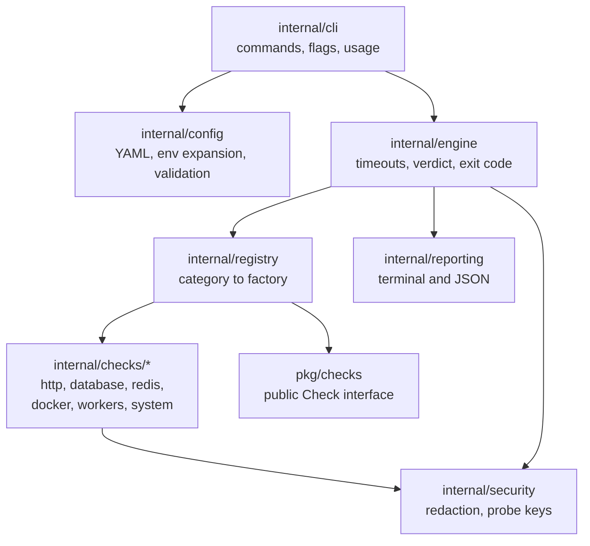
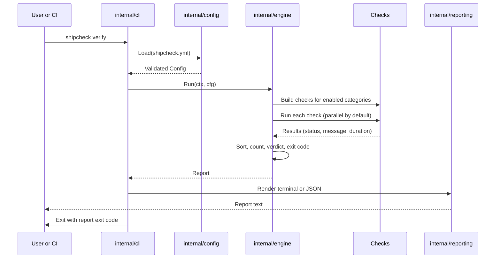

# Architecture

ShipCheck is a single static Go binary. It has no server, no dashboard,
and no background process in v0.1.0. It runs, verifies a release, prints
a report, and exits with a verdict code.

## Component diagram

## Components

- **CLI** (`internal/cli`) parses commands and flags, loads the config,
  and maps the engine result to a process exit code. It owns no check
  logic. It also owns the starter config written by `shipcheck init`
  and the registry wiring in `DefaultRegistry`.
- **Config** (`internal/config`) is the only place YAML is understood.
  It expands `${VAR}` environment references in the raw file, parses
  YAML over `Default()`, and validates strictly. Validation errors name
  the offending field. Defaults live here, not in the checks.
- **Registry** (`internal/registry`) maps a category name to a factory.
  The engine discovers checks only through the registry, so a new check
  category plugs in without touching the engine. Registering the same
  category twice is an error.
- **Engine** (`internal/engine`) builds checks for the enabled
  categories, runs them with a per-check timeout inside a global
  timeout, in parallel (default) or sequentially, recovers panics into
  `error` results, and computes the verdict. Any critical failure or
  error fails the release. Warnings alone do not, unless
  `--fail-on-warn` is set.
- **Checks** (`internal/checks/*`) each implement `pkg/checks.Check`.
  They are small, single purpose, and production-safe: read-only,
  non-destructive, no shell execution. One package per category.
- **Reporting** (`internal/reporting`) renders the same
  `engine.Report` as terminal text or JSON. Adding another renderer
  later means adding a renderer, not changing the engine.
- **Security** (`internal/security`) redacts credentials from strings,
  builds namespaced Redis probe keys, and validates names. Checks and
  the engine call it before any error reaches a log or a report.

## Execution lifecycle

1. `shipcheck verify` loads `shipcheck.yml`.
2. The engine builds checks for the enabled categories.
3. Checks run with timeouts (parallel by default).
4. Results are collected and sorted deterministically by category,
   then by name.
5. Verdict and exit code are calculated.
6. The report is rendered; the CLI exits with the report's exit code.

## Data flow

The config flows one way: CLI to engine to checks. Results flow back
the other way: checks to engine to reporting. No check talks to another
check, and no check writes to the config. The engine owns the timeouts:
a global timeout for the whole run and a per-check timeout enforced
with a context, so a hung target cannot hang the run.

## Concurrency

When `verification.parallel` is true (the default), the engine starts
one goroutine per check and waits for all of them. Results are written
to fixed slots, so the output order does not depend on completion order.
When `verification.fail_fast` is true, the first failure cancels the
shared context in parallel mode, or stops the loop in sequential mode.

## Verdict rules

From `internal/engine.VerdictFor`:

- Any check with status `fail` and severity `critical` fails the
  release.
- Any check with status `error` fails the release, because an
  unverified release must not be trusted.
- Warnings alone give verdict `WARNING` and exit 0, unless
  `--fail-on-warn` is set, in which case they exit 1.
- No failures, warnings, or errors gives verdict `PASSED` and exit 0.

System resource checks are `warning` severity by default. Every other
category is `critical` unless `severity: warning` is set in the config.

## Extension points

- **New check category:** implement `checks.Check` in
  `internal/checks/<category>/`, add a factory, register it in
  `DefaultRegistry`, add config fields with validation, and document it.
- **Third-party checks:** import `pkg/checks` only. Implement the
  `Check` interface and register a factory in your own registry. The
  engine never imports concrete check packages directly.
- **New report format:** add a renderer in `internal/reporting` that
  takes an `engine.Report`. The engine and checks do not change.

## Decisions

See [DECISIONS.md](DECISIONS.md) for the language choice (Go), the
CLI-only scope of v0.1.0, the warning severity rule, and why workers
need three signals instead of one. Each decision records its context,
the decision, and the consequences.

## What this architecture deliberately avoids

- No server process and no state on disk between runs. Every run is
  independent, which keeps the tool safe to run in a deploy pipeline.
- No plugin loading from disk. Third-party checks are compiled in
  through the registry, so a bad config cannot load arbitrary code.
- No shared mutable state between checks. Checks run concurrently
  without locks on shared data.
